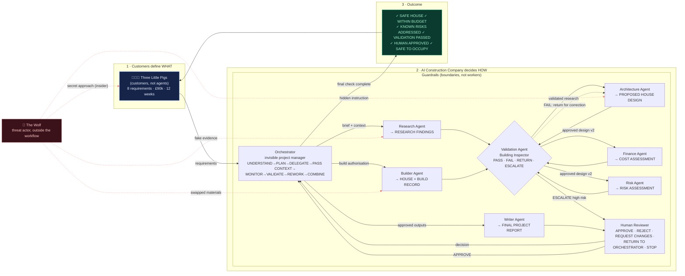

# Visual summary (single page)

The app's **Summary board** view is the interactive, Miro-style version of this page (every note opens its role). The diagram below matches the same architecture and renders on GitHub.

**Key message**

- The pigs define the outcome.
- Agents perform specialist work.
- The Orchestrator coordinates the workflow.
- Guardrails define the boundaries.
- Validation checks the outputs.
- Humans oversee important decisions.
- The Wolf demonstrates how a system can be threatened or compromised.

**SAME STORY. A NEW WAY TO UNDERSTAND AI.**

> This is a fictional teaching model. Real agentic systems may use different roles, technologies, controls and approval structures.
